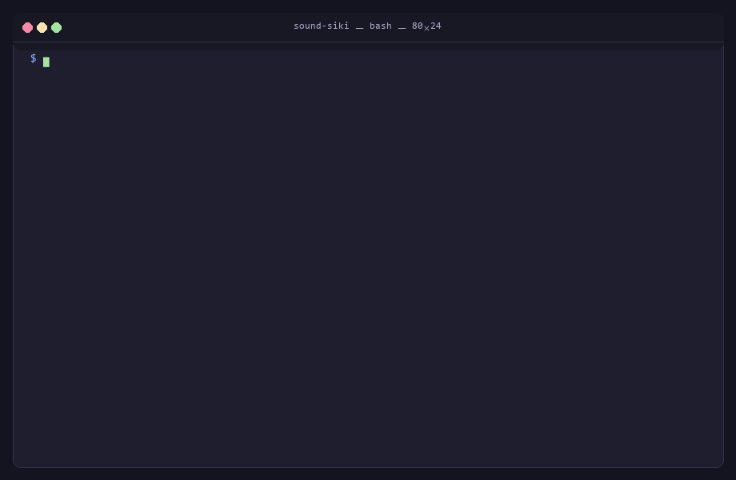
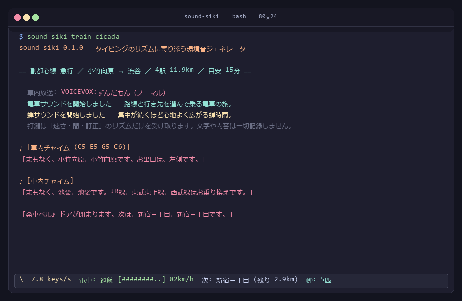
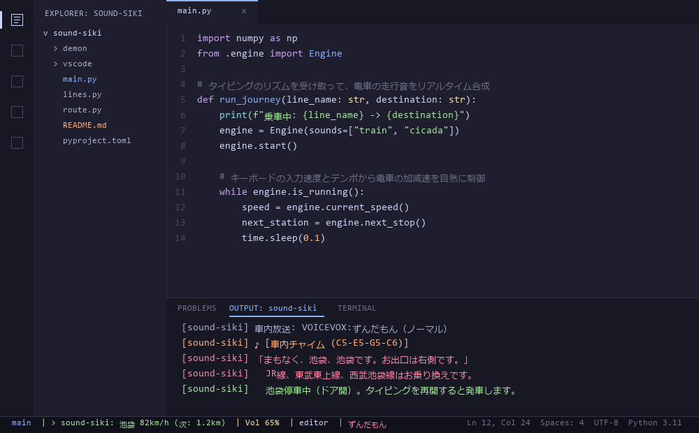
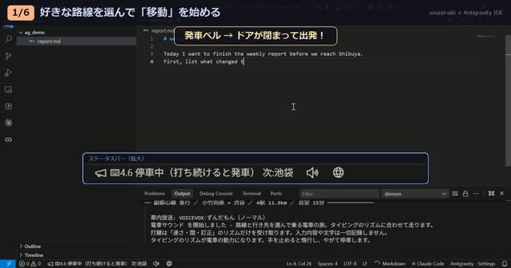
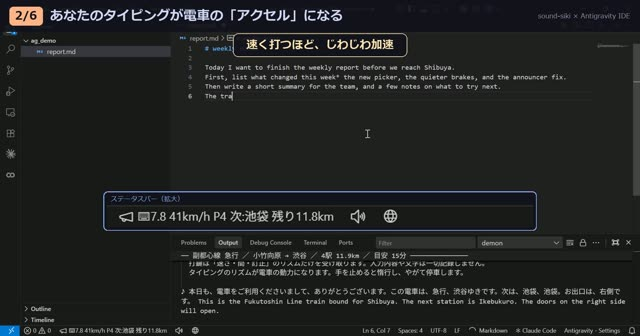
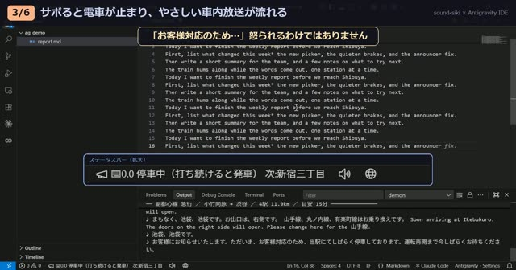
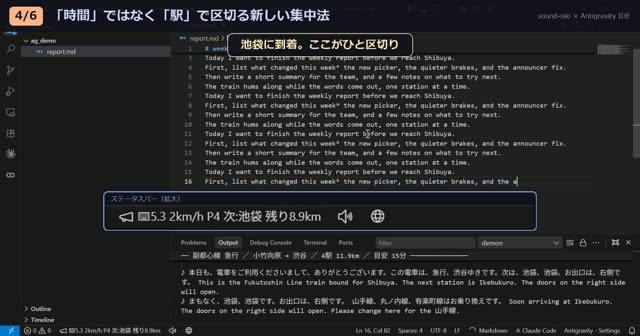
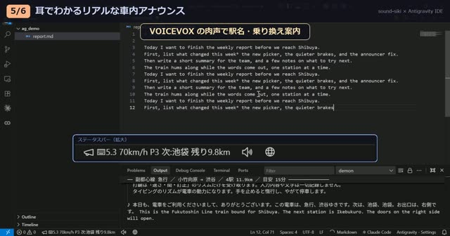
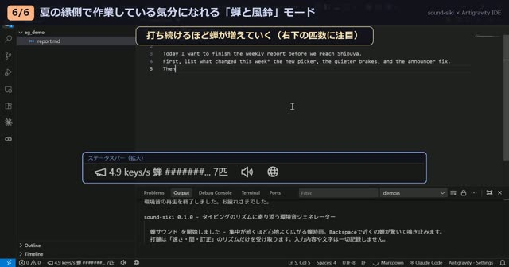

# sound-siki — タイピングのリズムに寄り添う環境音ジェネレーター

[English](README.en.md) | **日本語**

[](LICENSE)


新幹線や特急を使わない縛りで京都に行った帰り道、Wi-Fi がなかったのでオフラインで静かにコードを書いていました。
イヤホンで音楽を流すとどうしても気が散ってしまい、かといって完全な無音だと落ち着きません。
そこで思い切ってイヤホンを外し、電車の規則正しい走行音と、窓の外から響く蝉の声をそのまま作業 BGM にしてみたところ、驚くほど集中することができました。

YouTube などの動画で環境音を流すのも便利ですが、通信量を消費してしまいますし、何より少しロマンが足りません。
**録音された音源を再生するのではなく、その場でリアルタイムに合成する。しかも自分のタイピングのリズムに合わせて音が心地よく育っていく――**
そんな体験を目指して作られたのが、この環境音ジェネレーター **sound-siki** です。



音声ファイルなどの外部アセットは 1 バイトも含んでいません。インターネットへの通信も一切行いません。
ノイズの生成と四則演算だけで、電車の走行音も、蝉時雨も、風鈴も、その場ですべて生み出しています。

- **音源アセット**: **0 バイト**（起動時に numpy の計算式だけで合成）
- **ソースコード全体**: **約 111 KB / 2,850 行**
- **CPU 使用率**: 電車と蝉の音を同時に鳴らしても **1 コアの約 5%**
- **依存ライブラリ**: `numpy` / `sounddevice` / `pynput` のみ（コンパイラ不要）
- **使い方**: **ターミナル（CLI コマンド）** と **VS Code 拡張機能** の 2 通りを用意しています

---

## デモ画面

### ターミナルでの対話型運行
路線や行き先を選んで乗車すると、タイピング速度に合わせて電車が加速し、駅に近づくと自動で減速して到着します。



### VS Code 拡張機能
ステータスバーからワンクリックで乗車できます。エディタでのタイピングに連動し、作業中の邪魔をすることなく静かに寄り添います。



### 機能ごとのデモ動画（音声付き）
Antigravity IDE（VS Code 互換エディタ）で拡張機能を実際に使っている様子を、機能ごとに短く収録しました。サムネイルをクリックすると動画が開きます（**音声付きなので、ぜひ音を出してご覧ください**）。

| | |
|---|---|
| [](assets/videos/01-board.mp4)<br>**1. 好きな路線を選んで「移動」を始める**<br>ステータスバーから乗車。路線・種別・駅を選ぶと「目安 15分」が表示され、発車ベルとともに出発します。 | [](assets/videos/02-accelerate.mp4)<br>**2. タイピングが電車の「アクセル」になる**<br>速く打つほどじわじわ加速。手を止めると惰行し、やがて運転士がやさしくブレーキをかけます。 |
| [](assets/videos/03-held.mp4)<br>**3. サボると電車が止まり、車内放送が流れる**<br>駅で手を止めているとドアは開いたまま。「お客様対応のため…」の放送が、作業への復帰をそっと促します。 | [](assets/videos/04-stations.mp4)<br>**4. 「時間」ではなく「駅」で区切る**<br>打ち続けていても、運転士が駅にピタリと止めてくれます。駅に着いたらひと休み。 |
| [](assets/videos/05-announce.mp4)<br>**5. 耳でわかるリアルな車内アナウンス**<br>VOICEVOX 連携で、駅名や乗り換え案内を日本語＋英語の肉声で読み上げます。 | [](assets/videos/06-cicada.mp4)<br>**6. 「蝉と風鈴」モード**<br>打ち続けるほど蝉が1匹ずつ増えて蝉時雨に。Enter キーで風鈴が鳴ります。 |

---

## インストール

Python 3.9 以上が必要です。

### コマンドとして利用する場合（Windows / macOS / Linux）

```sh
pip install git+https://github.com/guousuides/sound-siki
sound-siki            # 路線を選んで乗車します（従来の demon コマンドでも動きます）
```

リポジトリをクローンして開発・実行する場合:

```sh
git clone https://github.com/guousuides/sound-siki
cd sound-siki
python -m venv .venv
# Windows:      .\.venv\Scripts\activate
# macOS/Linux:  source .venv/bin/activate
pip install -e .
```

#### OS ごとのポイント

- **macOS**: キーボード全体の打鍵リズムを感知するため、初回起動時に「システム設定 → プライバシーとセキュリティ → **アクセシビリティ**（および入力監視）」で、お使いのターミナルアプリを許可していただく必要があります。OS レベルの許可をしたくない場合は、後述の **VS Code 拡張機能** をご利用ください（許可不要で動作します）。
- **Linux**: `sounddevice` が PortAudio を使用するため、環境によっては `sudo apt install libportaudio2` が必要になる場合があります。キー監視は X11 環境に対応しています。
- クローンした環境では、同梱のランチャースクリプトを使って仮想環境を手軽に起動できます:
  - Windows: `.\demon.ps1 train cicada`
  - macOS / Linux: `./demon.sh train cicada`

---

### VS Code 拡張機能として利用する場合（Windows / macOS）

> [!NOTE]
> **Marketplace 未公開について**  
> 本拡張機能は現在、Visual Studio Marketplace には公開していません。  
> ご利用の際は、本リポジトリから VSIX パッケージをビルド（またはダウンロード）し、手動でインストールしていただく形となります。

`vscode/` フォルダに拡張機能が入っています。ターミナルを開かなくても、VS Code のステータスバーにある **▶ sound-siki** をクリックするだけで乗車できます。

```sh
cd vscode
npm run package                                   # typing-demon-0.1.0.vsix が生成されます
code --install-extension typing-demon-0.1.0.vsix
```

- 初回実行時に、拡張機能専用の仮想環境を自動作成し、`numpy` と `sounddevice` をセットアップします（要 Python 3.9 以上）。
- 路線・向き・種別・出発駅・目的駅は、VS Code のクイックピックでスムーズに選べます。前回の続きから乗車することも可能です。
- 打鍵は**エディタ内での文字編集イベント**から取得します（設定 `demon.keySource: editor`）。OS 全体のキーフックを使用しないため、macOS でも特別なアクセシビリティ許可は不要です。
- ステータスバーの 🔊 アイコンから、全体音量・電車音・蝉時雨・車内放送の音量を個別に調整できます（走行中でもリアルタイムに反映されます）。
- ステータスバーには現在の速度・次駅・残り距離が表示され、車内アナウンスの文字情報は出力パネル「sound-siki」に流れます。
- VOICEVOX がインストールされていれば、乗車時にバックグラウンドで自動起動し、VS Code 終了時に一緒に終了します。
- VS Code を閉じたときは電車の走行位置が自動保存され、次回スムーズに続きから再開できます。

詳しい使い方は [vscode/README.md](vscode/README.md) も併せてご覧ください。

---

## 使い方

```sh
sound-siki                       # 路線を選んで乗車します
sound-siki train cicada          # 電車サウンド + 蝉サウンドを同時に再生
sound-siki cicada --volume 0.85  # 音量を指定（既定値は 0.65）
sound-siki --lines               # 収録路線の一覧を表示
sound-siki --list                # 利用可能な環境音（サウンド）一覧を表示
sound-siki --devices             # 出力オーディオデバイス一覧を表示
```

> **Note**: 後方互換性のため、`sound-siki` の代わりに従来の `demon` コマンドや `python -m demon ...` でも同様に動作します。

電車サウンドでは、起動するたびに**どこからどこまで乗るか**を質問します。路線、進行方向、種別、出発駅、目的駅の順に番号を入力していくだけです（Enter キーを押すだけで既定値が選ばれます）。

```text
  どの路線に乗りますか
    1  山手線        内回り／外回り    30駅  34.5km   地上・周回。ジョイントが主役。
    2  中央線快速      下り／上り        24駅  53.1km   地上・高速。駅間が長い。
    3  副都心線       渋谷方面／和光市方面  16駅  20.2km   地下・全駅ホームドア。
  > 3

  ── 副都心線 急行 ／ 小竹向原 → 渋谷 ／ 4駅 11.9km ／ 目安 15分 ──
```

ここで**「目安 15分」**と表示されるのがポイントです。乗車する前に「今日の作業はどれくらいの時間にするか」を自然に決めることができます。

毎回選択するのが手間に感じる場合は、コマンドライン引数で指定してスキップすることもできます:

```sh
sound-siki train --line chuo --from 東京 --to 高尾 --kind 特別快速
sound-siki train --fresh            # 前回の続きをリセットして最初から乗る
sound-siki train --no-exit          # 終点に着いても終了せず、ホームで待機する
```

終了したいときは `Ctrl+C` を押すと、フェードアウトしながら安全に終了します。
また、**目的駅に到着したときも旅は終わります**。終点のアナウンスが流れたあと、ホームの音のまま 30 秒間の心地よい余韻を残して、走行サマリーを表示して静かに眠りにつきます。

タイピングせずに音だけを手軽に試したいときには、次のオプションが便利です:

```sh
sound-siki train --demo                            # スクリプトによる仮想タイピングで走行デモ
sound-siki train cicada --render out.wav --seconds 90   # 音声を WAV ファイルに直接書き出し
```

---

## タイピングと音のつながり

sound-siki が受け取るのは、**文字の内容ではなくリズム**です。
「速さ・持続・間・訂正」という 4 つの特徴量だけを大切に見守っています。

| 抽出する特徴 | 意味と役割 |
|---|---|
| `kps` | 1 秒あたりの打鍵数（時定数 3 秒でなめらかに平滑化） |
| `intensity` | `kps` を 0〜1 に正規化し、**さらにもう一段（時定数 6〜8 秒）落ち着かせた**駆動力 |
| `flow` | 「速さ」ではなく「**どれだけ持続しているか**」を溜める蓄積器（時定数 15〜20 秒） |
| `idle` | 最後の打鍵からの経過時間（秒） |

プログラミングや執筆のタイピングには、本来ムラがあります。一気に書いて、手を止めてじっくり考え、また書き始める――
そのムラをそのまま音に反映してしまうと、こちらの息切れや焦りがすべて聞こえてしまい、落ち着いて作業できません。
そのため、平滑化フィルターを二段重ねにしています。**タイピングの突風はそのまま突風にならず、ゆっくりと満ち引きする潮の満ち引きのように変換されます。**

---

### 電車サウンドのこだわり

```text
打鍵の速さ    → 主幹制御器（アクセルノッチ）。ただし電車には本物の質量があります
訂正（BS）     → ノッチが浅くなります。迷いながらの運転では速度が上がりません
車速          → ジョイント音の間隔・走行音の高さ・風切り音・VVVF の唸り
現在位置      → トンネル、曲線、分岐器、ホーム、そして車内放送
Enter         → 警笛（タイフォン）。ただし数分に一度だけ鳴ります
長い無音      → 惰行し、やがてブレーキ。駅に着いていればドアが開いたまま待機します
```

一番のこだわりは**電車の「質量」**です。キーを猛烈に連打しても、電車は急には加速しません。手を止めればスーッと惰行し、そのまま放置すると運転士さんがブレーキを入れて優しく停車します。

そして、この電車には**目的地（駅）**があります。線路の上を実際の営業キロに基づいて距離で進んでいるため、駅は必ずやってきます。

```text
力行   a = 0.83 · notch · taper(v) − 走行抵抗(v)     起動加速度 3.0 km/h/s
惰行   a = − 走行抵抗(v)
制動   a = − 1.00 · b                                常用最大 3.6 km/h/s
       v += a·dt ,  x += v·dt
```

**ブレーキはあなたの操作ではなく、電車のダイヤを守る運転士さんのものです。**
次の停車駅にピタリと止まるためにどれだけの減速が必要か（`v² / 2d`）を毎ブロック計算し、常用ブレーキの適切な強さに達したら、運転士さんが自動でブレーキをかけてくれます。どれだけ速く打っても駅は来ますし、駅では安全に停まります。

**アクセルはあなたのタイピング、運行ダイヤとブレーキは電車のもの。**
この絶妙な非対称性が、心地よい作業リズムと適度な緊張感を生み出します。

タイピングを頑張れば早く着きますが、駅間の短い路線では加速区間が限られるため、到着時間の差は 1〜2 割程度にとどまります（これは物理法則どおりです）。
本当に差が出るのは、**打つのをやめると電車が進まない**という点です:

| タイピングのペース | 副都心線 急行 和光市→渋谷（目安 23 分） |
|---|---|
| ずっと集中して打ち続けた場合 | **約 24 分** |
| 3 分打って 3 分休憩を繰り返した場合 | 約 44 分 |
| 2 分打って 5 分休憩を繰り返した場合 | 約 72 分 |
| 10 分に 1 分だけ打つペースの場合 | **約 191 分** |

さらに駅に到着したあとは、**タイピングが再開されるまでドアが閉まりません**。
そのまま放置していると、車内にやさしい放送が流れます:

> ♪ お客様にお知らせいたします。ただいま、お客様対応のため、当駅にてしばらく停車しております。

少し手が止まってしまったときも、電車のやさしいアナウンスが作業への復帰をそっと後押ししてくれます。

---

### 地形と物理に基づいたサウンド生成

以前のバージョンでは、Enter キーを押したときにトンネル、Backspace を押したときに分岐器をランダムに鳴らしていました。
現在の sound-siki では、電車が線路上の位置を持っているため、**「そこに実在するから鳴る」**ようになりました。

- **トンネル**: その路線の実際のトンネル突入メートル地点を通過したときに突入音が響きます
- **分岐器（ポイント）**: 渡り線のある駅の進入側を通過するときに「カランコロン」と揺れます
- **曲線の軋り音**: カーブ区間を通過するときに車輪とレールが軋みます
- **ジョイント音**: `floor(x / 25)` が切り替わるたびにレールの継ぎ目音が鳴ります

副都心線が和光市駅を出発してすぐに地下へ潜るのも、Enter を押したからではなく、**そこに地下トンネルの入口があるから**です。

ジョイント音は数式で計算しています。日本の定尺レールは 25 m、台車の軸距は約 2.4 m、台車間は約 14 m です。1 本の継ぎ目を 1 両の車両が通過すると、打音は正確に 4 回（「ガタン・ゴトン」）鳴り、その打音の間隔は車速で割った値そのものになります。

> **裏話**: 副都心線は 2008 年開業のロングレール路線のため、現実にはほとんどジョイント音が鳴りません。しかし、「電車の旅にガタンゴトンがないのは少し寂しい」という想いから、音量を 42% に抑えてほんのり鳴るようにしてあります。

---

### 車内放送 —— 音源ファイルも TTS も使わずに喋る

sound-siki は「外部音声ファイルを 1 バイトも持たず、ソケット通信も開かない」という設計原則で作られています。
そのため、標準の車内放送も録音データではなく、**四則演算（フォルマント加算合成）**だけで喋らせています。

日本語は 5 つの母音で構成されるモーラ等時性の言語です。駅名は、**毎秒約 7 拍の母音のリズム**として表現できます。

- 母音は加算合成。基本周波数の倍音列に、3 つのフォルマント共振フィルターを適用します
- 車内スピーカーの帯域（330〜3300 Hz）にフィルタリングし、短い遅延タップを足して車内反響を再現します
- 子音（破裂、摩擦、鼻音、わたり）を母音の前に添えることで、音節の切れ目をくっきりと出します

意味を明瞭に聞き取ることは難しいですが、**これはあえて狙った設計**です。意味は画面のログで確認でき、耳に届くのは「駅名が何拍あるか」「どこでイントネーションが上下するか」という音楽的な抑揚だけです。作業に没頭しているときに邪魔にならず、それでいて「駅が変わったな」と自然に伝わります。

---

### VOICEVOX による温かみのある肉声アナウンス

「もっと本物のような車内放送を楽しみたい！」という方のために、**ローカルで起動している VOICEVOX と連携して肉声で案内する機能**も備えています。
特別な設定をしなくても、sound-siki が自動でローカルのエンジンを探しにいき、見つからなければ静かに上記のフォルマント合成へと切り替わります。

1. [VOICEVOX](https://voicevox.hiroshiba.jp/) をインストールして起動しておきます（`127.0.0.1:50021` で待機します）。
   Windows であれば、アプリ本体を開かずに同梱の `.\start-voicevox.ps1` を実行するだけでエンジンだけを裏で起動できます。
2. いつもどおり `sound-siki train` を実行します。起動時に `車内放送: VOICEVOX:ずんだもん（ノーマル）` と表示されれば準備完了です。

```sh
sound-siki train --speaker 8                        # 話者スタイル ID を指定（既定値 3 = ずんだもん）
sound-siki train --announce japanese                # 英語放送を省いて日本語のみにする
sound-siki train --voicevox http://127.0.0.1:10101  # AivisSpeech などの互換エンジンも指定可能
sound-siki train --voice synth                      # 常に数式フォルマント合成のみを使用する
sound-siki train --announce-volume 0.5              # 車内放送の音量だけを半分に調整 (0〜2)
sound-siki train cicada --cicada-volume 0.4         # 蝉の音だけを小さく調整
```

- **日英バイリンガル放送**: 始発駅での案内、次駅・出口案内、乗り換え路線案内、終点案内が、実在の鉄道フォーマットで日英両方流れます
- **車内サイン音（4点チャイム）**: 放送直前に鳴るおなじみのチャイム（C5-E5-G5-C6）も、音源ファイルを使わず `numpy` の数式（減衰正弦波）だけでその場で合成しています
- 一度合成された音声文は `~/.demon/voice/` にキャッシュされるため、二度目以降は高速に再生されます
- 通信はローカルの `127.0.0.1` とのみ行われ、インターネットには一切接続しません

> **音声クレジットについて**: 利用する音声キャラクターの利用規約（ずんだもん等）に従ってご利用ください。

---

### 蝉サウンドのこだわり

```text
flow（持続度）  → 鳴いている蝉の個体数（遠くの 1 匹から、やがて広がる蝉時雨へ）
Backspace 連発 → 近くの数匹が驚いて鳴き止み、時間が経つとじわじわ戻ってきます
Enter         → 縁側の風鈴（チリンと鳴ります）
20 分の持続    → ヒグラシが加わり、昼下がりから夕暮れへと空気が移ろいます
```

蝉サウンドは、タイピングの「速さ」ではなく**「続いているか（flow）」**に反応します。
一瞬だけ速く打っても蝉は増えません。淡々とタイピングを続けていると、少しずつ周囲の木々から蝉の声が重なり、厚みを増していきます。

アブラゼミ、ミンミンゼミ、ヒグラシの鳴き声を周波数変調とパルスで合成し、個体ごとに再生レート・定位・位相をずらしているため、長時間聴いていても耳が疲れない、自然な合唱を作り出しています。

---

## プライバシーとセキュリティ

sound-siki のコマンド版（および VS Code 拡張の `global` モード）は、タイピングのリズムを計測するためにキーボード入力を検知します。
そのため、**プライバシーの保護を最優先事項として設計しています**。

- `keywatch.py` の入力コールバックから外に出力されるのは、`0〜3` の 4 つの整数分類（文字 / スペース / 訂正 / 改行）のリズム情報のみです。
- **入力された具体的な文字、キーコード、ウィンドウ名、打鍵時刻などの情報は一切保持せず、即座に破棄します。**
- ネットワーク通信は、ローカルで動いている VOICEVOX (`127.0.0.1`) 宛て以外には一切行いません。
- Shift や Ctrl などの修飾キーもカウント前に破棄されます。

### ディスクに書き込まれる唯一のデータ

前回の続きから乗車できるようにするため、`~/.demon/journey.json` に旅の現在地のみを保存します:

```json
{ "version": 1, "line": "chuo", "kind": "特別快速", "direction": 1,
  "origin": "東京", "dest": "高尾",
  "x_m": 7535.8, "elapsed_s": 600.0, "sessions": 1 }
```

ここにも、**タイピングに関する情報（打鍵数や入力速度など）は 1 バイトも記録されません**。
書かれているのは「電車が路線の何メートル地点にいて、何秒走行したか」という電車の運行データだけです。
終点に到着すればこのファイルも自動的に削除されます。

VS Code 拡張機能の既定モード（`editor`）では、OS のキーフックすら使用しません。エディタ内の文字編集イベントからリズムを抽出するため、安心してお使いいただけます。

---

## プロジェクト構成

すべての重い計算は**「起動時に 1 回だけ行う」**というシンプルな構造になっています。

1. `prepare()` で、周波数領域からノイズバッファを合成します（`dsp.noise_loop`）。ランダム位相を掛けて逆 FFT することで、継ぎ目のない完全なループ音声を作ります。
2. リアルタイムの再生コールバックでは、生成済みのバッファを可変レートで読み出して加算するだけで動作します。

```text
demon/
  dsp.py        ノイズ合成・ループ再生・単発音スケジューラ（numpy のみ）
  keywatch.py   打鍵 → リズム特徴量抽出。文字内容は入り口で破棄
  engine.py     リアルタイムオーディオループ・マスター出力・WAV 書き出し
  lines.py      収録路線データ（駅・営業キロ・トンネル・曲線・分岐器）
  route.py      電車の運転力学（ノッチと制動、位置計算。音の知識は持たない）
  announce.py   フォルマント加算合成による車内アナウンス
  voice.py      ローカル VOICEVOX との連携
  journey.py    走行位置の保存と復元
  picker.py     ターミナルでの対話型路線選択メニュー
  demons/
    base.py     環境音サウンドの基底クラス
    train.py    電車サウンド
    cicada.py   蝉サウンド
vscode/         VS Code 拡張機能
assets/         デモ動画・スクリーンショット画像
```

---

## 新しい環境音（サウンド）を追加する

`Demon` 基底クラス（`demon/demons/base.py`）を継承して `prepare()` と `render()` を実装し、`demon/demons/__init__.py` の `REGISTRY` に登録するだけで、誰でも新しい環境音を追加できます。

- 雨の音（タイピングの勢いに合わせて雨脚が強まる）
- 焚き火の音（タイピングが続くと薪がパチパチとはぜる）
- 喫茶店のざわめき（作業が進むと店内に心地よい活気が生まれる）

など、アイデア次第で様々な環境音の世界を広げることができます。

---

## コントリビューション

Issue や Pull Request は大歓迎です！
新しい鉄道路線の追加、新しい環境音のアイデア、macOS や Linux での動作レポートなど、お気軽にどうぞ。
詳しくは [CONTRIBUTING.md](CONTRIBUTING.md) をご覧ください。

---

## ライセンス

[MIT License](LICENSE) © 2026 guousui

本ソフトウェアのコードは MIT ライセンスです。VOICEVOX で生成された音声は本リポジトリに含まれず、各キャラクター・音声エンジンの利用規約に従います。路線データ（駅名・営業キロ）は公開情報をもとに作成されたものであり、各鉄道事業者様とは無関係です。
